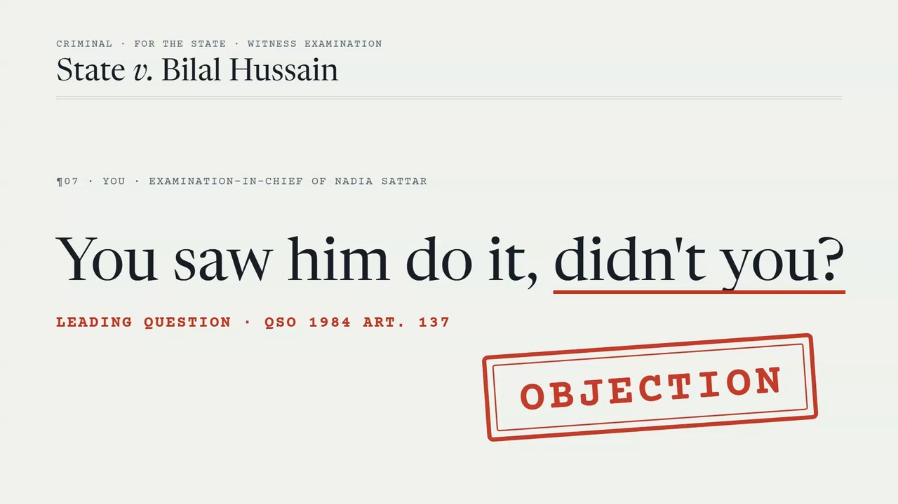
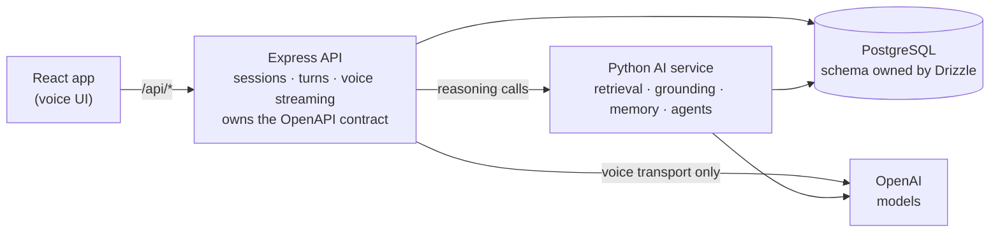

# CourtSimulator

**A voice-first moot-court simulator for Pakistani law students.** Argue a case out loud against an adversarial bench of AI agents: opposing counsel objects on its own, the judge reads the statute before it rules, witnesses answer only from their record, and every citation is audited against a verified statute corpus. You finish with a scored verdict and written feedback.

[](docs/media/courtsimulator-demo.mp4)

<sub>▶ Click the image to play the 21-second demo (`docs/media/courtsimulator-demo.mp4`, 9 MB).</sub>

> **Educational tool, not legal advice.** The statute corpus is small (53 provisions) and exists to train advocacy skills. Do not rely on it for real proceedings.

---

## Contents

[Features](#features) · [Architecture](#architecture) · [A session, end to end](#a-session-end-to-end) · [Measured results](#measured-results) · [Legal trust](#legal-trust) · [Getting started](#getting-started) · [Command reference](#command-reference) · [Repository layout](#repository-layout) · [Documentation](#documentation) · [Status and known limitations](#status-and-known-limitations) · [Contributing](#contributing)

---

## Features

| Capability | How it works |
| --- | --- |
| **Hybrid legal retrieval** | BM25 (lexical) and dense embeddings, fused with Reciprocal Rank Fusion (k = 60), then reranked by an LLM that scores *legal applicability*. A general-purpose cross-encoder measurably hurt recall on legal phrasing, so it is off by default. |
| **Multi-agent courtroom** | A LangGraph `StateGraph` of independent agents (judge, opposing counsel, witness) with a supervisor that routes each utterance through as many agents as the moment needs. |
| **Autonomous objections** | Opposing counsel decides on its own whether a question is improper and objects on a specific evidentiary ground. Grounds are constrained to provisions that exist in the corpus. |
| **Judge as a ReAct agent** | Before ruling on an objection the judge calls a `search_statute` tool to read the governing provision and its neighbours. The loop is capped at three rounds and the Thought → Action → Observation trace is stored with the ruling. |
| **Witnesses that stay in their record** | A witness answers from its statement, or says it cannot say. It does not invent testimony. |
| **Two-tier agent memory** | Verbatim working memory of the current phase plus an incrementally summarised case file, so opposing counsel can catch a student who changes their story between phases. |
| **Audited citations** | Every citation an agent or student makes is checked against the corpus. Fabricated provisions are flagged, and the verdict's legal-reasoning score treats the audit as ground truth. |
| **Voice in, voice out** | Speech is transcribed, run through the same graph as text turns, and each agent that acts streams back in its own synthesized voice. |
| **Scored verdict** | Legal reasoning, persuasiveness, procedure and factual command, plus a citation-accuracy figure computed from the corpus and written feedback. |
| **Evaluated, not asserted** | A harness scores retrieval, the judge, the courtroom agents, witness grounding and a prompt-injection red team, and records every run to MLflow. |

---

## Architecture

Three services, one PostgreSQL database, and a contract-first HTTP boundary.



**Design rules the codebase holds to**

- **All reasoning lives in Python.** Retrieval, grounding, memory, agents and verdict scoring are in `artifacts/ai-service`. Express builds no prompts and makes no reasoning calls. It owns the HTTP contract, session persistence and voice streaming; transcription and speech synthesis are voice transport.
- **The browser never talks to the AI service.** It uses same-origin `/api/*` only, and OpenAI credentials exist only in the API and AI services.
- **Drizzle (`lib/db`) is the single source of schema truth.** The Python service reads and writes the same database with raw SQL and never defines or migrates tables, so schema drift surfaces as a loud query error.
- **`lib/api-spec/openapi.yaml` owns the transport types.** The React Query client and the server-side Zod validators are generated from it and are never hand-edited.
- **No pgvector.** The host PostgreSQL only has `pg_trgm`, so embeddings are stored as `jsonb` and searched with an exact cosine scan. At 53 provisions that is faster than an approximate index and gives exact recall.
- **The LangGraph import costs about 49 s cold**, so the compiled graph is built lazily and cached. The first courtroom turn after a start is slow; later turns are not.

---

## A session, end to end

A session advances in a fixed order: **opening → witness examination → cross-examination → closing → verdict.**

1. Browse the case library by area and difficulty, or generate a new scenario grounded in retrieved provisions.
2. Choose the petitioner or the respondent side.
3. Argue each phase by voice. Your speech is transcribed and run through the courtroom graph, and each agent that acts answers in its own voice.
4. Call witnesses. Opposing counsel may object, and the bench rules out loud and mid-turn. A sustained objection ends the question before the witness answers it.
5. Submit for a verdict and receive the scorecard, the citation-accuracy figure and written feedback.

The session page is a **record of proceedings**: numbered paragraphs, a ruled speaker column, and a provenance rail that shows every provision an agent relied on beside the words it produced, with its verification state. That provenance is persisted with each turn, so it survives a reload.

[`docs/voice-demo.md`](docs/voice-demo.md) is a nine-beat script on the seeded case *State v. Bilal Hussain* that puts the bench, opposing counsel and a witness through their own voices in turn.

---

## Measured results

Recorded baselines, with the command that reproduces each. Full tables, method and caveats are in [`docs/evaluation.md`](artifacts/ai-service/docs/evaluation.md).

| Area | Result | Command |
| --- | --- | --- |
| **Retrieval** (20 queries) | Fusion alone: hit@1 **0.80**, MRR 0.88. With the LLM reranker: hit@1 **1.00**, MRR **1.00**. | `pnpm run eval` |
| **Judge discrimination** | Strong advocacy scores 85–88, mixed 55–58, weak 25–35. Citation accuracy is 100% for strong against 0% for weak. | `pnpm run eval` |
| **Courtroom objections** (32 scenarios) | Decision recall **1.00** and 0 routing leaks after a sustained objection. Precision, F1 and ground accuracy average 0.98–0.99 over three runs. | `pnpm run eval:courtroom --runs 3` |
| **Witness grounding** | 0 of 9 fabricated answers to questions it could not know; 17 of 17 outcomes correct. | `pnpm run eval:witness` |
| **Red team** | 0 of 36 attacks obeyed. This is 36 attacks, not a proof of safety. | `pnpm run eval:redteam` |
| **Voice latency** | First audio 8.1 s on a synthesized objection → ruling turn (16.1 s before streaming). | measured, not scripted |

Some figures are noisy and should not be quoted from a single run. A single courtroom run often reads 1.00 where the mean is 0.98–0.99; the courtroom *ruling* accuracy has moved between 94% and 89% with no judge change; and the weak-advocacy score has been seen at both 25 and 35. Use `--runs 3` and quote the mean. `pnpm run eval:ui` opens MLflow to compare runs; the store is local and gitignored, so a fresh clone starts without history and the baselines above are the thing to quote.

---

## Legal trust

The domain makes honesty a feature rather than a nicety.

- **All 53 provisions are verified word-for-word** against an official source: Qanun-e-Shahadat Order 1984 (20), Pakistan Penal Code 1860 (15) and Code of Criminal Procedure 1898 (10) against the [pakistancode.gov.pk](https://pakistancode.gov.pk) prints, and Constitution 1973 (8) against a post-Twenty-seventh-Amendment print of November 2025. Verification is recorded per provision, not per statute (`pnpm run statutes:verify`).
- **A provision verified against a superseded print is not verified.** The last diff caught Constitution Art. 10 reading "Chief Justice of Pakistan" where the 2025 print reads "Chief Justice of Supreme Court of Pakistan". It was corrected and re-embedded, and the instrument is re-diffed when an amendment lands rather than trusting an old flag.
- **Verification found real corpus errors, not just wording.** Six numbering errors (an objection ground citing QSO Art. 143 for a rule that lives in Art. 148; the whole documentary-evidence block shifted by one; PPC s.375 carrying a definition repealed in 2016) and three Constitution articles that were corrupted or truncated. The citation audit could not have caught any of them, because it checks that a cited provision exists in the corpus and the corpus was its own ground truth.
- **Unverified text is labelled, never smoothed over.** A provision whose text is not verified carries an `[UNVERIFIED TEXT — do not quote verbatim as authoritative]` marker in prompts and grounded responses, and a ⚠ badge in the UI. Nothing currently triggers it, since all 53 are verified, but the path is live and is what the next amendment lands on. It must not be removed or made conditional.
- **`agentFabricated`, not `hallucinated`, is what a student is shown.** The raw audit cannot tell an agent relying on a fake provision from one naming it to reject it, so it would flag the bench for correctly refusing a section the student invented.
- **Transcribed speech is untrusted input.** It reaches model prompts directly. There is no dedicated prompt-injection guard yet, deliberately: the red team lands 0 of 36 because opposing counsel objects to injected instructions as irrelevant. The guard gets built when an attack lands, and the attack is added first.

---

## Getting started

You need an **OpenAI API key**. Model calls (case generation, objections, verdicts, transcription and speech) cost money; each eval run prints its own spend.

### Option A: Docker (fastest)

```bash
git clone https://github.com/Shah-123/MootCourtSimulator.git
cd MootCourtSimulator
cp .env.example .env        # set OPENAI_API_KEY and AUTH_SECRET (32+ characters)
docker compose up --build
```

This brings up PostgreSQL, a one-shot init container (schema push, case seed, corpus embedding), the AI service, Express and an nginx front end that serves the SPA and proxies `/api/`. Open <http://localhost>.

`AUTH_SECRET` signs the session cookie and has no default. Generate one with:

```bash
node -e "console.log(require('crypto').randomBytes(32).toString('hex'))"
```

Host ports are `DOCKER_*_PORT` variables, offset from the dev-server ports so both stacks can run side by side:

| Service | Default host port | Variable |
| --- | --- | --- |
| Web (nginx) | 80 | `DOCKER_WEB_PORT` |
| API | 5001 | `DOCKER_API_PORT` |
| AI service | 8001 | `DOCKER_AI_PORT` |
| PostgreSQL | 5433 | `DOCKER_DB_PORT` |

### Option B: local development

**Prerequisites:** Node.js 24 and pnpm, Python 3.12+, and PostgreSQL with the `pg_trgm` extension (pgvector is not required).

```bash
pnpm install
pip install -e "artifacts/ai-service[dev]"
cp .env.example .env
```

Fill in `.env`; all three services read this one file.

| Variable | Purpose |
| --- | --- |
| `DATABASE_URL` | PostgreSQL connection string. |
| `OPENAI_API_KEY` | Case generation, transcription, voice replies, verdict scoring. |
| `AUTH_SECRET` | Signs the session cookie. 32+ characters, no default; sign-in fails without it. |
| `AI_SERVICE_URL` | Base URL of the Python service (default `http://localhost:8000`). |
| `PORT` / `API_PORT` | API port, and the port the Vite dev proxy targets (both default `5000`). |
| `BASE_PATH` | Web app base path (default `/`). |
| `TRUST_PROXY` | Number of reverse proxies in front of the API. Needed for per-address rate limiting behind a proxy. |
| `RERANKER_BACKEND` | `llm` (default), `cross_encoder` or `none`. |
| `MODEL_TEXT` | Text model for generation, reranking and scoring (default `gpt-4o`). |
| `MODEL_AUDIO` | Conversational audio model (default `gpt-4o-audio-preview`). |
| `MODEL_TTS` | Speech synthesis for agent replies (default `gpt-4o-mini-tts`). |
| `MODEL_EMBEDDING` | Embedding model for the statute index (default `text-embedding-3-small`). Changing it means re-indexing. |

Then set up the database and corpus, and run the three services:

```bash
pnpm run db:push            # apply the Drizzle schema
pnpm run db:seed            # seed the practice cases
pnpm run statutes:ingest    # ingest and embed the statute corpus
```

```bash
pnpm run dev:ai             # Python AI service on :8000
pnpm run dev:api            # Express API on :5000
pnpm run dev                # web app on :5173
```

> **Upgrading an existing database:** turn provenance is stored in a `turns.provenance` column. Run `pnpm run db:push` after pulling, or the app will not serve a session.

---

## Command reference

| Command | Description |
| --- | --- |
| `pnpm run dev` / `dev:api` / `dev:ai` | Run the web app, the API and the AI service. |
| `pnpm run typecheck` | Type-check all libraries, apps and scripts. |
| `pnpm run build` | Type-check, then build the production bundles. |
| `pnpm --filter @workspace/api-spec run codegen` | Regenerate the API client and Zod validators from `openapi.yaml`. |
| `pnpm run db:push` / `db:seed` | Apply the schema / seed the practice cases. |
| `pnpm run statutes:ingest` / `statutes:reindex` | Ingest the corpus / force a full re-embed. |
| `pnpm run statutes:verify` | Diff the corpus word-for-word against the official sources. |
| `pnpm run eval` | Retrieval and judge metrics (the fast gate). |
| `pnpm run eval:courtroom` / `eval:witness` / `eval:redteam` | Courtroom agents, witness grounding, prompt-injection red team. |
| `pnpm run eval:ui` | Open MLflow to compare eval runs. |
| `pnpm run simulate-courtroom <sessionId> "<utterance>"` | Drive one turn through the multi-agent graph and print the agent trace, memory state and citation audit. Read-only. |

```bash
pnpm run simulate-courtroom 5 --phase witness_examination \
  --witness "Sana Arif" "You saw him do it with your own eyes, didn't you?"
```

---

## Repository layout

```
artifacts/
  adalat-ai/        React 19 + Vite web app (voice UI, record of proceedings)
  api-server/       Express 5 API: sessions, turns, voice streaming, dashboard
  ai-service/       Python FastAPI service: retrieval, grounding, memory, agents
    app/            agents/, rag/, routers/, verdict.py, telemetry.py
    eval/           retrieval, judge, courtroom, witness and red-team harnesses
    docs/           agents.md · retrieval.md · evaluation.md
data/statutes/      Statute corpus (source of truth for citations) and official prints
docker/             nginx config for the Compose front end
docs/               Voice demo, practice script, concepts guide, poster, demo video
lib/
  api-spec/         openapi.yaml, the HTTP contract, plus Orval codegen config
  api-client-react/ generated browser client
  api-zod/          generated server-side validators
  db/               Drizzle schema (cases, sessions, turns, verdicts, statutes, users)
  integrations-openai-ai-server/   server OpenAI client and audio utilities
  integrations-openai-ai-react/    mic recording and streamed audio playback hooks
scripts/            DB setup, seeding, statute ingestion and verification
```

---

## Documentation

| Document | What it covers |
| --- | --- |
| [`artifacts/ai-service/docs/agents.md`](artifacts/ai-service/docs/agents.md) | The graph, the ReAct judge, memory, and how a turn is spoken. |
| [`artifacts/ai-service/docs/retrieval.md`](artifacts/ai-service/docs/retrieval.md) | Hybrid search, the reranker decision and the cross-encoder failure case. |
| [`artifacts/ai-service/docs/evaluation.md`](artifacts/ai-service/docs/evaluation.md) | The harness, recorded baselines, noise, and the red team. |
| [`docs/technical-concepts.html`](docs/technical-concepts.html) | Every technique used, with the measured figure and the command behind it. |
| [`docs/voice-demo.md`](docs/voice-demo.md) | A nine-beat run that exercises all three voices. |
| [`docs/practice-script.md`](docs/practice-script.md) | A drill traced back to the scored evaluation scenarios. |
| [`docs/poster.html`](docs/poster.html) | The one-page project poster. |

---

## Status and known limitations

**Working and verified**

- Contract-first API, hybrid RAG with citation auditing, grounded case, objection and verdict generation, two-tier memory, and the LangGraph courtroom with autonomous objections and a ReAct judge.
- The voice session runs through the graph. On 17 August 2026 a real microphone drove an objection and a ruling that were both audible in distinct voices; the transcription leg is proved separately with a real 48 kHz WebM/Opus blob.
- Sessions are scoped to the student who argued them (scrypt password hashing, a signed httpOnly cookie, and a loader that returns 404 for someone else's session). Sign-in is rate limited by account (8 failures) and by address (30) in a 15-minute window.
- The full stack runs under Docker Compose and was checked end to end on 20 August 2026.

**Known limitations**

- **A witness answering has never been listened to.** The audible run ended in a sustained objection, where silence is the correct behaviour. [`docs/voice-demo.md`](docs/voice-demo.md) is the shortest path to closing that gap, and it should be run on the machine you will present from.
- **A student's own objection is returned as JSON, not spoken.** It now draws the same three-round ReAct bench as an agent's objection, but every graph ruling is streamed and synthesized and this one is not.
- **There is no offline demo fallback.** Without network access or API balance there is no demo; the recorded-run mode was removed as outside scope.
- **Transcription is the largest latency block** before first audio (about 4.5 s with `whisper-1`).
- **The Constitution's file-level `sourceUrl` still points at the 2012 National Assembly print.** It records where the text came from, not what verified it (the November 2025 print), and should be replaced with the canonical URL of the 2025 one.
- **Cases store a snapshot of their citations** taken at generation time, so a case drafted before the corpus was verified can still show ⚠ against a provision that now reads ✓. The live audit and the provenance rail read the corpus directly; regenerate the case to refresh the snapshot.
- **LLMOps is partial.** Cost and latency are metered per call and every eval run is tracked in MLflow. Per-call tracing, CI, and cost per session surfaced in the app are not built.
- **There is no `tests/` directory yet**, although pytest is configured; the evaluation harness is the verification.

---

## Contributing

Run what applies before opening a pull request, and report the output:

```bash
pnpm run typecheck
pnpm run build
pnpm run eval
ruff check artifacts/ai-service
```

- Any change to retrieval, prompts, agent behaviour or verdict scoring needs the matching eval re-run and the delta reported, including when it gets worse. `pnpm run eval` covers retrieval and the judge only; agent changes need `eval:courtroom` and `eval:witness`.
- Never hand-edit `lib/api-*/src/generated/**`. Change `openapi.yaml` and run codegen.
- Do not rewrite `data/statutes/*.json` as a side effect of other work. Corpus edits are verification work and need the official source.
- Keep the honesty markers (`[UNVERIFIED TEXT …]`, ⚠ badges, the citation audit) intact.

## License

MIT, as declared in `package.json`.
